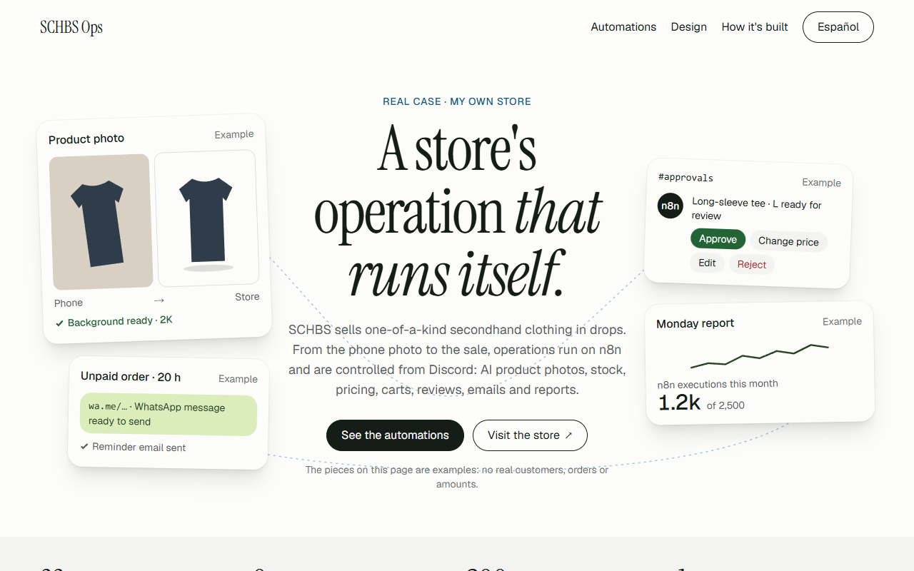
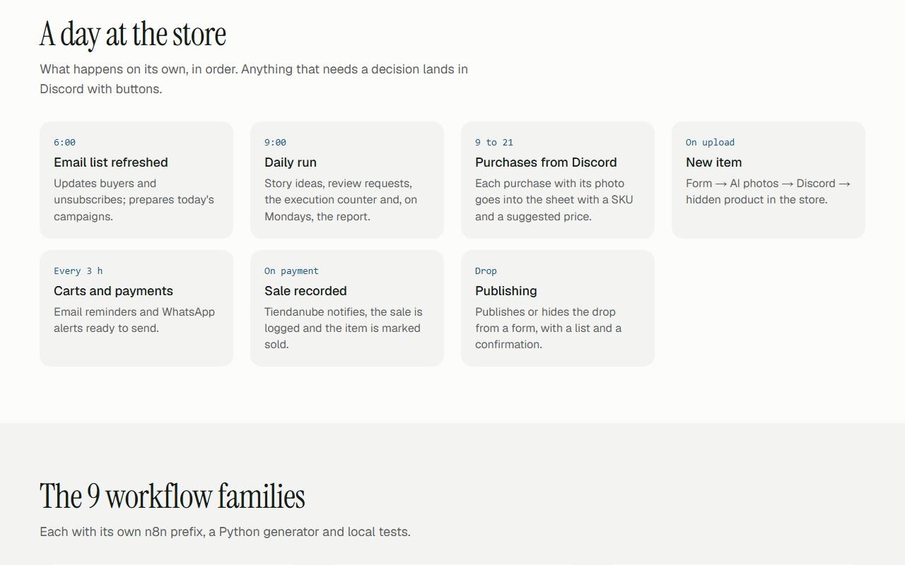
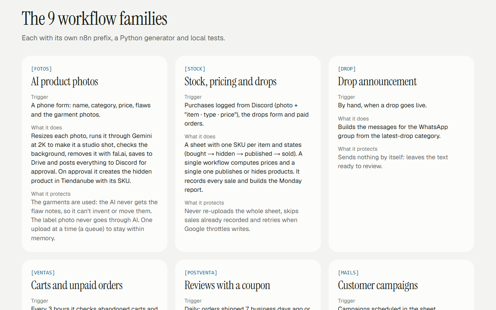
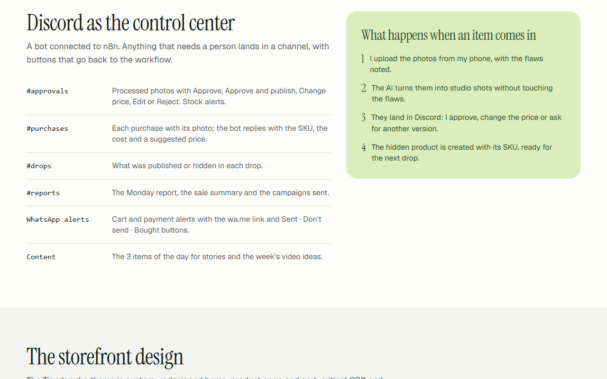
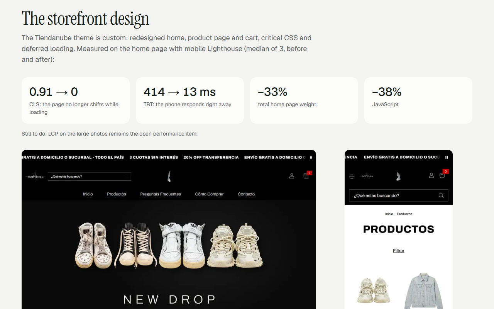
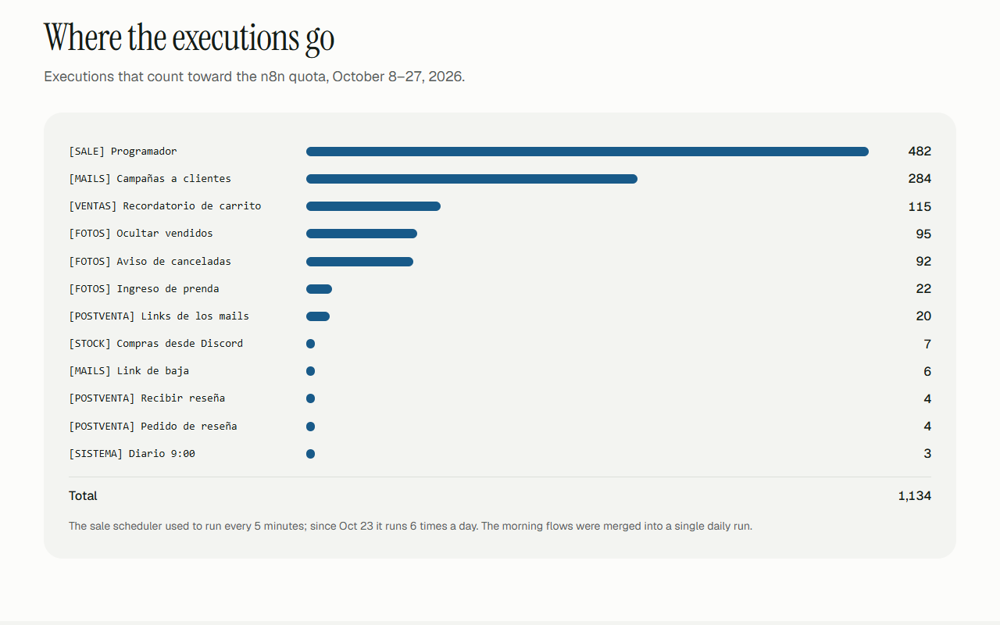
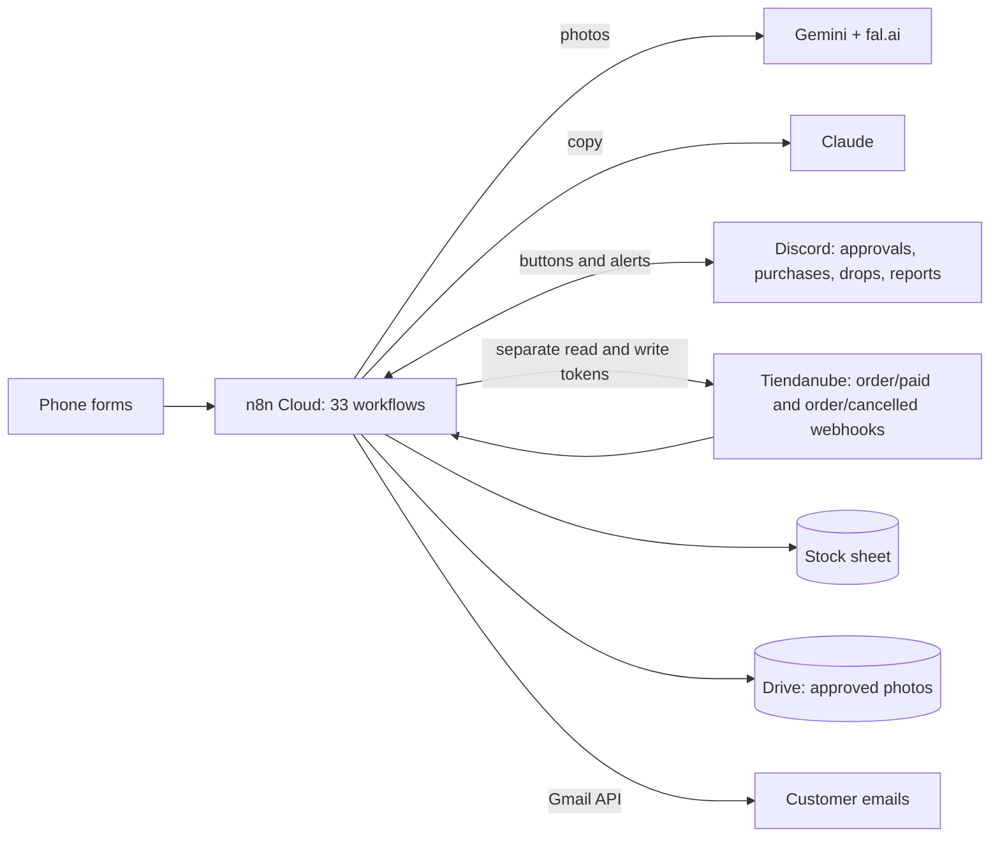

# SCHBS Ops · A real store's operation, automated

A case-study page showing how **[schbscorp.com](https://schbscorp.com)** runs: a one-of-a-kind secondhand clothing store
that sells in drops on Tiendanube, operated by 33 n8n workflows in 9 families, a Discord control center, AI for photos
and content, a stock sheet, emails and alerts, plus a custom storefront design.
· [Versión en español](README.md)


> **This is a real case**: the store belongs to Germán Schouabs. The page shows no customer data, orders, amounts,
> costs or IDs; the hero pieces are labeled examples.

## The problem

A store of one-of-a-kind items works differently from a regular shop: every garment is photographed, measured,
described with its flaws and published exactly once. Add drops, carts, unpaid orders, reviews, emails and content, and
day-to-day operations eat the time meant for selling.

## The solution

| Family | What it handles |
|---|---|
| `[FOTOS]` | Phone form → studio shots with Gemini and fal.ai → approval in Discord → hidden product in Tiendanube with its SKU. The AI never gets the flaw notes and the label photo never goes through AI. |
| `[STOCK]` | A sheet with SKUs and states, purchases logged from Discord, a single place to price and a single place to publish, recorded sales and a Monday report. |
| `[DROP]` | Drop messages for WhatsApp, ready to review. |
| `[VENTAS]` | Abandoned carts and unpaid orders: an email plus a WhatsApp alert ready to send. |
| `[POSTVENTA]` | Review requests with a unique coupon and approval in Discord. |
| `[MAILS]` | Campaigns through the Gmail API, in batches, with one-click unsubscribe and dry-run/test/live modes. |
| `[SALE]` | Sale scheduler: pauses and reactivates coupons and sends notices at key moments. |
| `[CONTENIDO]` | Daily story ideas and 7 video ideas a week, written with Claude without access to prices. |
| `[SISTEMA]` | A single daily trigger and an execution counter to protect the n8n quota (2,500 a month). |

The page also shows the store's custom design (Tiendanube theme) with before/after measurements, and a board with the
real executions per workflow.

## Demo

| | |
|---|---|
|  |  |
|  |  |
|  |  |

## Architecture



## How it's built

- Each workflow is written by a **Python generator** that outputs the JSON, so it's versioned and reviewable.
- **Backup and commit before upload**; the upload script stops if the change isn't committed.
- Flows that email customers go through **dry run, test and live**.
- Code-node logic is tested with **node** before upload.
- **Security:** a read-only token to read the store and the write token only in the nodes that write; credentials by
  name; never test orders with real items.

## Running the page

```bash
npm install
npm run dev          # http://localhost:3209 (and /en)
npm run build && npm run test:e2e     # 12 tests: content, languages, privacy and axe, desktop and mobile
npm run lighthouse   # mobile, median of 3
npm run contraste    # AA color pairs
```

The page is static: no keys or external services. Store screenshots are taken from public pages with
`node scripts/capturas-tienda.mjs`.

## Measured results (Nov 2, 2026)

| Check | Result |
|---|---|
| e2e + axe (`npm run test:e2e`) | **12/12**: content and anchors, language switch, no emails/phones/IDs on the page, axe with no serious violations, desktop and mobile |
| Mobile Lighthouse (median of 3) | `/` **97**/100/100/100 · `/en` **97**/100/100/100 |
| Contrast | 16/16 pairs at AA |

Operation figures come from the store's own documentation: workflows as of Oct 30, 2026, executions Oct 8–27, 2026, and
the store home measurement (mobile Lighthouse, median of 3, before and after the redesign).

## Design

Based on the **Steep** style from Refero Styles, adapted (Instrument Serif + Geist, pampas blue and yerba green). See [`docs/brand.md`](docs/brand.md).

## Author

Developed by Germán Schouabs.

## License

MIT. See [LICENSE](LICENSE).
