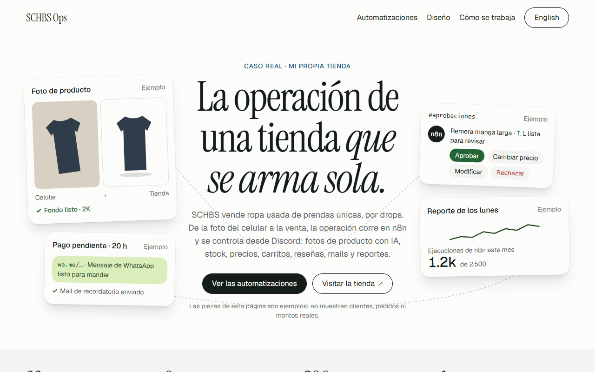
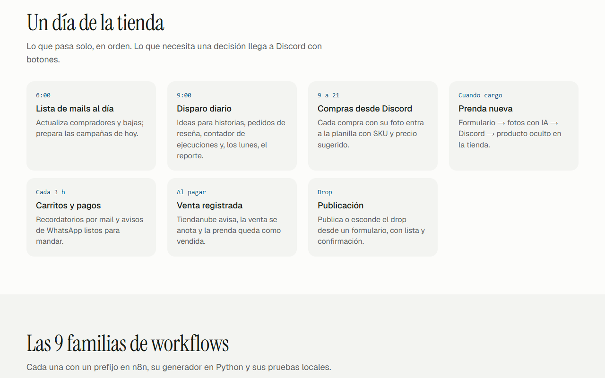
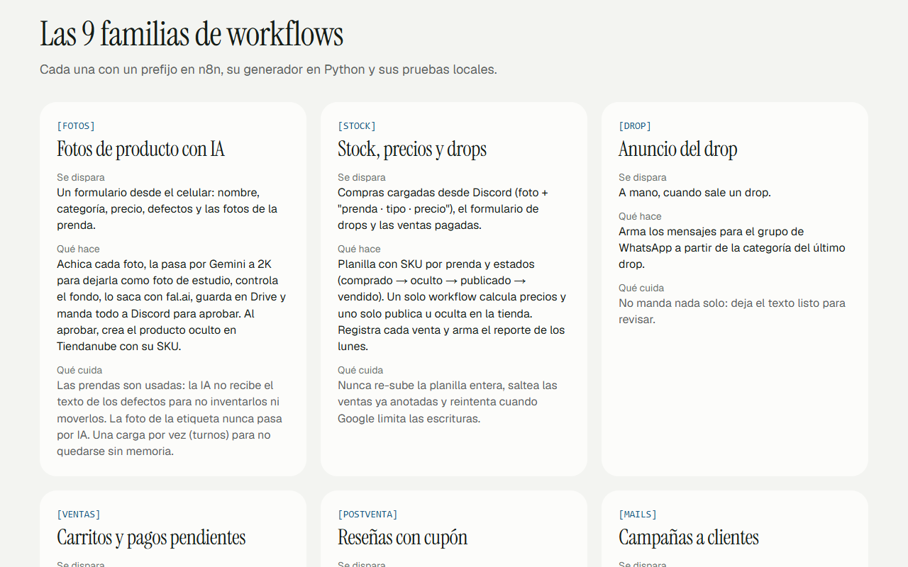
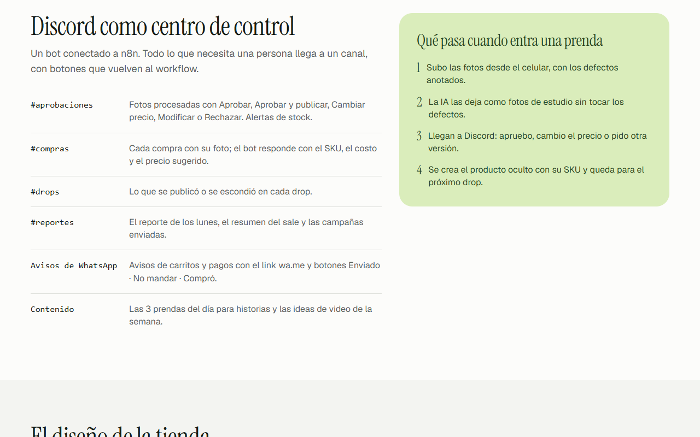
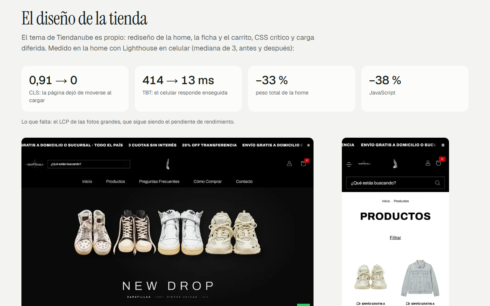
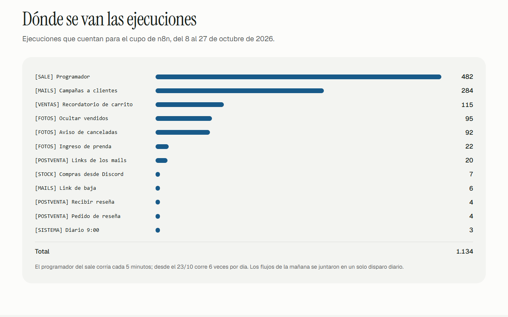
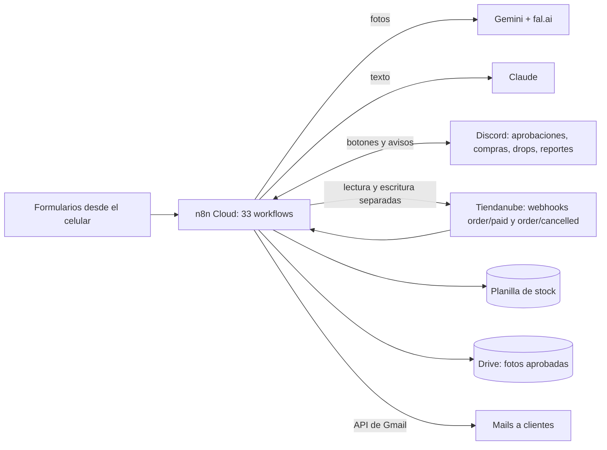

# SCHBS Ops · La operación de una tienda real, automatizada

Página de caso que muestra cómo funciona la operación de **[schbscorp.com](https://schbscorp.com)**, una tienda de ropa
usada de prendas únicas que vende por drops en Tiendanube: 33 workflows de n8n en 9 familias, Discord como centro de
control, IA para fotos y contenido, planilla de stock, mails y avisos, y el diseño propio de la tienda.
· [English version](README.en.md)


> **Es un caso real**: la tienda es de Germán Schouabs. La página no muestra datos de clientes, pedidos, montos, costos
> ni IDs; las piezas del hero son ejemplos y lo dicen.

## El problema

Una tienda de prendas únicas tiene un trabajo distinto al de una tienda común: cada prenda se fotografía, se mide, se
describe con sus defectos y se publica una sola vez. Con drops, carritos, pagos pendientes, reseñas, mails y contenido,
la operación diaria se come el tiempo de vender.

## La solución

| Familia | Qué resuelve |
|---|---|
| `[FOTOS]` | Formulario desde el celular → fotos de estudio con Gemini y fal.ai → aprobación en Discord → producto oculto en Tiendanube con su SKU. La IA no recibe el texto de los defectos y la foto de la etiqueta nunca pasa por IA. |
| `[STOCK]` | Planilla con SKU y estados, compras cargadas desde Discord, un solo lugar para calcular precios y uno solo para publicar, ventas registradas y reporte de los lunes. |
| `[DROP]` | Mensajes del drop para WhatsApp, listos para revisar. |
| `[VENTAS]` | Carritos abandonados y pagos pendientes: mail y aviso de WhatsApp listo para mandar. |
| `[POSTVENTA]` | Pedido de reseña con cupón único y aprobación en Discord. |
| `[MAILS]` | Campañas por la API de Gmail, en tandas, con baja de un clic y modos simulacro/prueba/real. |
| `[SALE]` | Programador del sale: pausa y reactiva cupones y avisa en los momentos clave. |
| `[CONTENIDO]` | Ideas diarias para historias y 7 ideas de video por semana, escritas con Claude sin acceso a precios. |
| `[SISTEMA]` | Un solo disparo diario y un contador de ejecuciones para cuidar el cupo de n8n (2.500 por mes). |

La página además muestra el diseño propio de la tienda (tema de Tiendanube) con su medición antes y después, y un
tablero con las ejecuciones reales por workflow.

## Demo

| | |
|---|---|
|  |  |
|  |  |
|  |  |

Capturas en inglés en [`docs/capturas/en/`](docs/capturas/en/).

## Arquitectura de la operación



## Cómo se trabaja

- Cada workflow se escribe con un **generador en Python** que produce el JSON: se versiona y se revisa.
- **Backup y commit antes de subir**; el script de subida frena si el cambio no está commiteado.
- Los flujos que escriben a clientes pasan por **simulacro, prueba y real**.
- La lógica de los nodos de código se prueba con **node** antes de subirla.
- **Seguridad:** token de lectura para leer la tienda y de escritura solo en los nodos que escriben; credenciales por
  nombre; nunca pedidos de prueba con prendas reales.

## Cómo correr la página

```bash
npm install
npm run dev          # http://localhost:3209 (y /en)
npm run build && npm run test:e2e     # 12 pruebas: contenido, idiomas, privacidad y axe, en compu y celular
npm run lighthouse   # móvil, mediana de 3
npm run contraste    # pares de color en AA
```

La página es estática: no usa claves ni servicios externos. Las capturas de la tienda se sacan de las páginas públicas
con `node scripts/capturas-tienda.mjs`.

## Resultados medidos (02/11/2026)

| Prueba | Resultado |
|---|---|
| e2e + axe (`npm run test:e2e`) | **12/12**: contenido y anclas, cambio de idioma, sin mails/teléfonos/IDs en la página, axe sin violaciones serias, en compu y celular |
| Lighthouse móvil (mediana de 3) | `/` **97**/100/100/100 · `/en` **97**/100/100/100 |
| Contraste | 16/16 pares en AA |

Las cifras de la operación salen de la documentación de la tienda: workflows al 30/10/2026, ejecuciones del 8 al 27/10/2026
y la medición de la home de la tienda (Lighthouse en celular, mediana de 3, antes y después del rediseño).

## Diseño

Basado en el estilo **Steep** de Refero Styles y adaptado (Instrument Serif + Geist, azul pampa y verde yerba). El
diseño completo y su control de diferencia están en [`docs/brand.md`](docs/brand.md).

## Autoría

Desarrollado por Germán Schouabs.

## Licencia

MIT. Ver [LICENSE](LICENSE).
